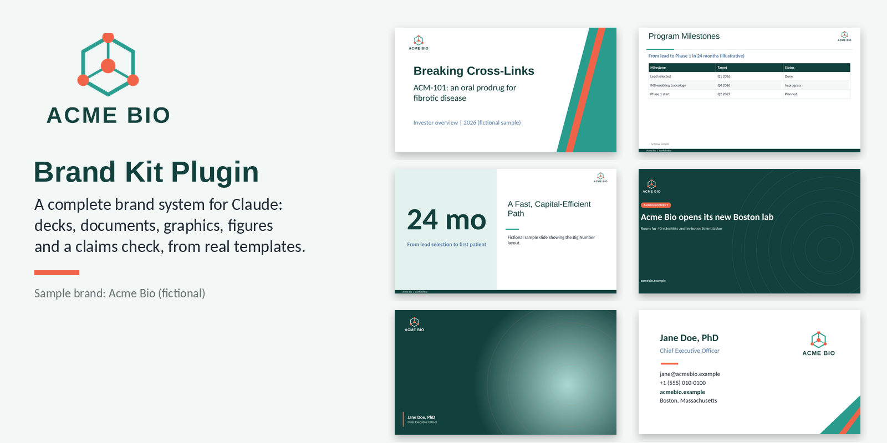
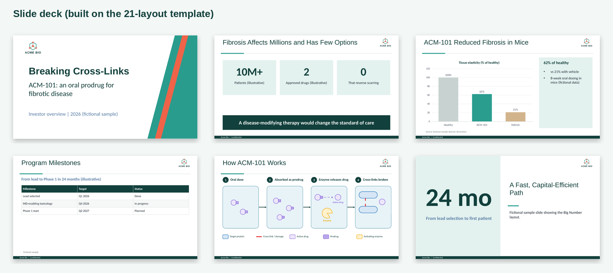
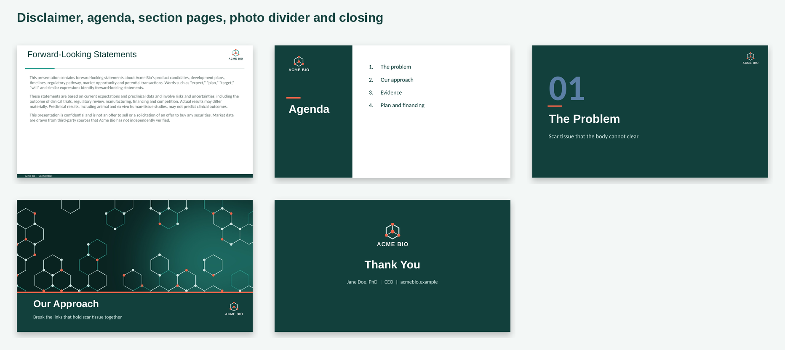
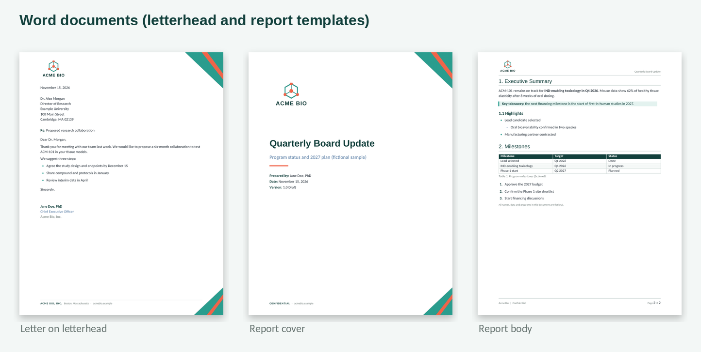
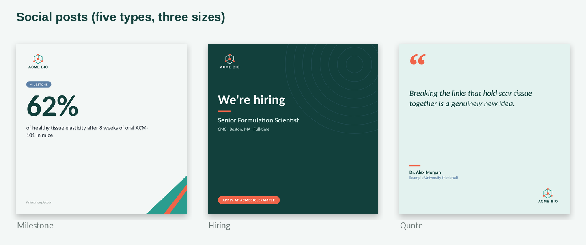
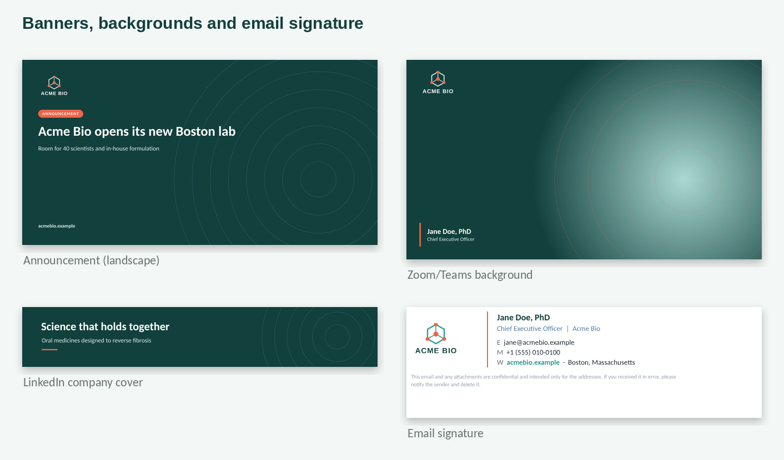
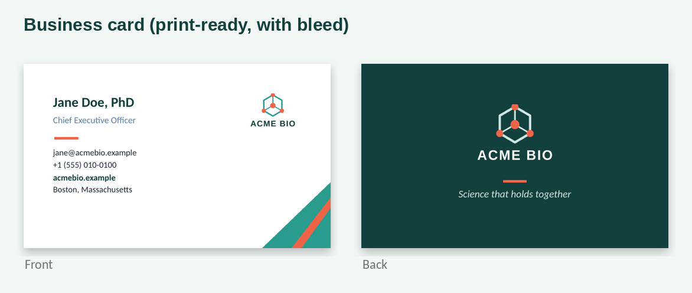
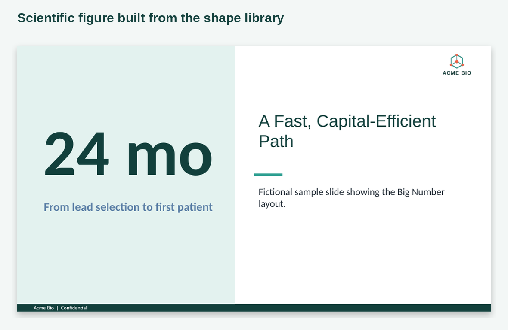
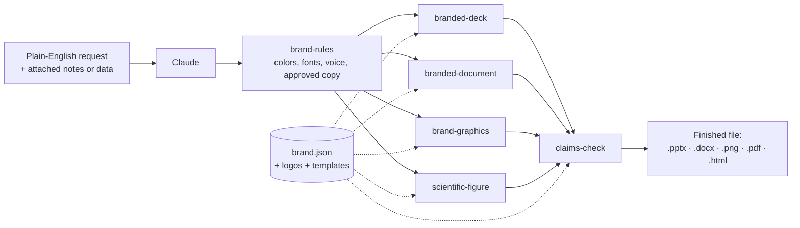

# Brand Kit Plugin

**A complete company brand system, packaged as a Claude plugin.**

Ask Claude in plain English for a pitch deck, a letter on letterhead, a LinkedIn post, business cards, a
Zoom background or a mechanism-of-action figure. Claude builds the file from real PowerPoint and Word
templates, in the company's colors, fonts and voice. Before anything goes outside the company, a built-in
claims check reviews it for overstated scientific or investor claims.

I built this for **[Lento Bio](https://lentobio.com)**, a preclinical biotech startup that had a pitch deck
and no brand system. Lento Bio's version, with its real brand and data, stays private. This public version runs on **Acme Bio, a fictional brand** with made-up
data, so you can see how it works and point it at your own brand.

| | |
| --- | --- |
| **What it is** | A Claude plugin: 6 skills, 5 Python tools, 3 Office templates, a logo set and 41 icons |
| **What it makes** | `.pptx` decks, `.docx` letters, reports and memos, `.png` social posts, banners and backgrounds, print-ready `.pdf` business cards, `.html` email signatures, editable science figures, claims reports |
| **Who it's for** | Small companies (especially life sciences) with no in-house designer |
| **Re-brandable** | Change one settings file, swap the logos, run one script |

## The problem

Small life-sciences companies produce a steady stream of material (investor decks, board reports, partner
letters, conference posts, grant figures) with no designer and no brand system. So every file looks
different, numbers and company descriptions drift from file to file, risky language like "cures" or
"clinically proven" slips into investor material, and hours go into fonts and logos instead of content.

## What I built

The work went in three stages, starting from a single PDF pitch deck.

| Stage | Deliverables |
| --- | --- |
| **1. Template** | The PDF deck rebuilt as editable PowerPoint, then turned into a corporate template with **21 layouts** (covers, agenda, four kinds of section page, content, comparison, chart, table, statement, big number, quote, disclaimer, closing) and theme colors, fonts, logo, footer, slide numbers and transitions built in |
| **2. Brand kit** | Letterhead, report and memo formats; email signatures; print-ready business cards; Zoom/Teams backgrounds; LinkedIn and X banners; five social post types in three sizes; an icon library; a scientific illustration style; approved company descriptions from tagline to 200 words |
| **3. Plugin** | Everything packaged as **six Claude skills** with Python tools behind them, so anyone can produce on-brand work by asking in plain English, and check it before it goes out |

## Gallery

Everything below was generated by the plugin's own scripts, from the fictional Acme Bio brand.

**Slide decks** built on the 21-layout template:

**Word documents:** letter on letterhead, report cover and body:

**Social posts, banners, backgrounds and email signature:**

**Business cards** (print-ready PDF with bleed) and **scientific figures** (editable PowerPoint shapes):

**Claims check:** run on a deliberately bad [sample press release](examples/sample_draft_press_release.txt),
it produces [this report](docs/sample-claims-report.md) with 12 findings, from "first drug that reverses
fibrosis" and "clinically proven" to an efficacy number with no model or duration.

## The six skills

| Skill | Ask for things like | You get |
| --- | --- | --- |
| **brand-rules** | anything for the company | Colors, fonts, logo rules, voice, approved copy and facts. Every other skill builds on it |
| **branded-deck** | "Make a 10-slide investor update from these notes" | Editable `.pptx` on the corporate template, with native charts, branded tables, stat cards and speaker notes |
| **branded-document** | "Letter on letterhead to Dr. Morgan", "board report", "staff memo" | Editable `.docx` on the letterhead or report template |
| **brand-graphics** | "Square milestone post", "Zoom background", "business cards for everyone in this file" | PNG posts and banners, 1920×1080 backgrounds, print-ready card PDFs, HTML signatures |
| **scientific-figure** | "Mechanism-of-action slide for our drug" | Editable figure slides in one illustration style, with a fixed color for each biological element |
| **claims-check** | "Check this press release before it goes out" | A severity-ranked report of risky claims, unsupported data, placeholders and off-brand styling, with suggested rewrites |

→ **[Full detail on each skill](docs/skills.md)**: layouts, functions, graphic sizes, figure colors and
claims rules.

## How it works

- **One source of truth.** `brand.json` holds the name, colors by role, fonts and footer. Every tool reads it,
  so changing a color in one place changes every output.
- **Real templates, not imitations.** Decks and documents are built on the actual `.potx` and `.dotx` files,
  so the output stays editable for people who never use Claude.
- **Skills say when and how; scripts do the repeatable work.** The tenth deck looks like the first.
- **Check before handing over.** Claude renders and inspects every output, then runs the claims check on
  anything external.

## Quick start

1. Download this repository (**Code → Download ZIP**) and unzip it.
2. Zip the **contents** of the folder so `.claude-plugin/` is at the top level, and name the file
   `brand-kit-plugin.plugin`.
3. In Claude, open the `.plugin` file, add it, and start a new conversation.

Then try: *"Make a 6-slide investor update for Acme Bio from these notes"*, *"Make a square milestone post:
62% of healthy tissue elasticity after 8 weeks in mice"*, or *"Check this press release before we send it."*

**More:** [use it for your own brand](docs/rebranding.md) · [run the scripts directly](docs/scripts.md)

## Design decisions

- **Templates first, generation second.** Filling real layouts gives the same look every time and keeps files
  editable.
- **Colors by role, not by name.** Tools ask for `primary` or `accent`, never a hex value. That makes the kit
  re-brandable from one file and keeps meaning consistent: "our result" is always the accent color.
- **Semantic color for science.** Each biological element always has the same color, so figures read the
  same across decks, papers and posters.
- **HTML for graphics, native shapes for figures.** Posts and cards render pixel-exact through Chromium;
  figures stay editable PowerPoint shapes a scientist can adjust.
- **The claims check is a screen, not a judge.** Patterns catch the obvious problems; Claude reads the whole
  piece in context and proposes rewrites. It is editorial guidance, not legal advice.
- **Personal data stays out of Git.** Batch cards and signatures read a `people.json` that is git-ignored.

## Privacy

This repository contains no real company's data. The brand (Acme Bio), its logo, the product (ACM-101), all
numbers and all people are fictional. Lento Bio's version is kept in a separate private repository.
Lento Bio is named only as the company this was built for.

## Credits

Icons: [Tabler Icons](https://tabler.io/icons) (MIT, see [`assets/icons/LICENSE-tabler.txt`](assets/icons/LICENSE-tabler.txt)). Built with python-pptx,
python-docx, Pillow and Playwright. The Acme Bio brand and sample data are fictional.

© 2026 Sathish. All rights reserved. This repository is shared for viewing; please ask before reusing the code.

Designed and built by Sathish.
